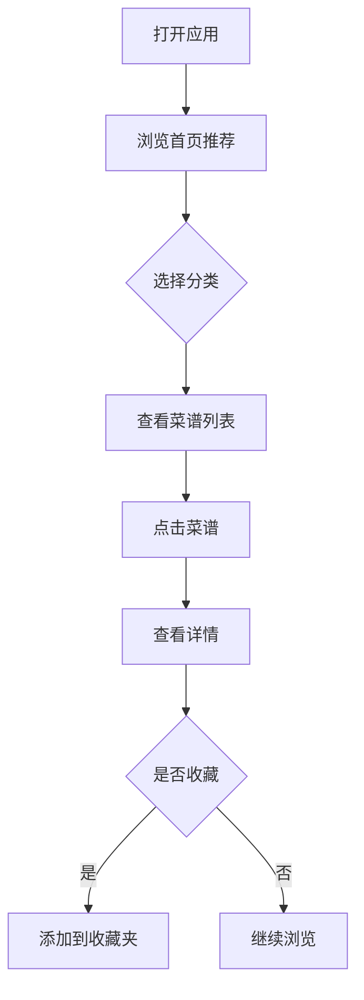
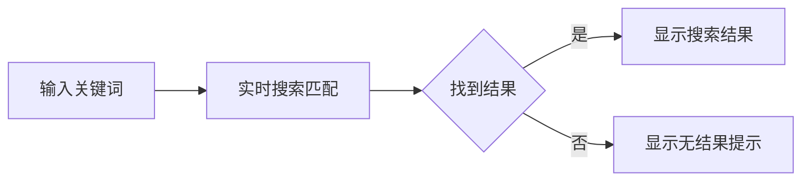

# 菜谱应用产品需求文档

> 实施现状：工程已从「Vite + React Web」迁移为 **Expo (SDK 58) + React Native + expo-router** 移动端应用，
> Expo 工程位于 `mobile/`，仓库根为 bun workspace。数据结构见 `mobile/src/types/index.ts`，
> 技术架构见同目录 `TechnicalArchitecture.md`。

## 1. 产品概述

一款简洁优雅的菜谱收藏与管理应用，帮助用户发现、收藏、分享美味食谱。

- **核心目的**：让用户轻松管理个人菜谱库，快速查找和浏览食谱
- **目标用户**：烹饪爱好者、家庭主厨、美食达人
- **产品价值**：简洁高效的操作体验，精美的视觉呈现

## 2. 核心功能

### 2.1 用户角色
| 角色 | 注册方式 | 核心权限 |
|------|---------|----------|
| 访客 | 无需注册 | 浏览菜谱列表和详情 |
| 用户 | 本地存储 | 收藏菜谱、管理个人收藏夹 |

### 2.2 功能模块

1. **首页浏览**
   - 菜谱分类导航（川菜、粤菜、湘菜、西餐、甜点等）
   - 热门推荐菜谱展示
   - 搜索功能

2. **菜谱详情**
   - 菜谱封面图
   - 食材清单
   - 步骤说明
   - 烹饪小贴士

3. **收藏管理**
   - 收藏/取消收藏
   - 我的收藏列表

4. **菜谱录入**（可选功能）
   - 添加新菜谱
   - 编辑已有菜谱

## 3. 核心流程

### 3.1 浏览菜谱流程


### 3.2 搜索流程


## 4. 用户界面设计

### 4.1 设计风格
- **风格定位**：温暖、温馨、食物感
- **主色调**：焦糖柿子橙 `#D96B38` 作为主色，搭配燕麦暖画布 `#F5F2EB` 背景
- **辅助色**：
  - 深炭棕 `#26211E` 用于文字
  - 次级文字 `#857C74`，浅标签底 `#F3EFE8`
- **难度色**：简单 `#4E7D63` / 家常 `#C87D28` / 进阶 `#C4514B`
- **字体**：
  - 标题：Noto Serif SC（衬线体，有文化感）
  - 正文：Noto Sans SC（无衬线，易读）
- **布局风格**：卡片式布局，圆角设计，柔和阴影
- **图标风格**：线性图标，食物相关emoji点缀

### 4.2 页面设计概览

| 页面 | 模块 | UI元素 |
|------|------|--------|
| 首页 | 分类导航栏 | 横向滚动，图标+文字 |
| 首页 | 热门推荐 | 大图卡片，菜谱名+简介 |
| 首页 | 搜索框 | 圆角输入框，搜索图标 |
| 详情页 | 封面图 | 全宽图片，高度约40%屏幕 |
| 详情页 | 食材区 | 标签式展示，勾选样式 |
| 详情页 | 步骤区 | 数字序号，步骤描述 |
| 收藏页 | 收藏列表 | 网格/列表切换，删除功能 |

### 4.3 响应式设计
- **桌面端**：多列卡片布局，最大宽度1200px居中
- **移动端**：单列布局，底部导航栏
- **触控优化**：按钮最小44px点击区域

## 5. 数据结构

### 5.1 菜谱数据
```typescript
interface Recipe {
  id: string;
  name: string;
  category: string;
  coverImage: string;
  description: string;
  ingredients: Ingredient[];
  steps: Step[];
  tips: string;
  cookTime: number; // 分钟
  difficulty: 'easy' | 'medium' | 'hard';
  createdAt: string;
}

interface Ingredient {
  name: string;
  amount: string;
}

interface Step {
  order: number;
  description: string;
  image?: string;
}
```

### 5.2 分类数据
```typescript
interface Category {
  id: string;
  name: string;
  icon: string;
  count: number;
}
```
