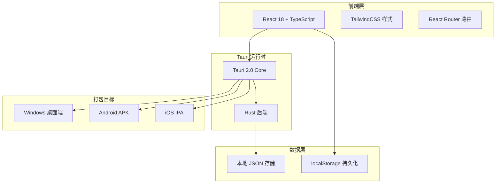

# 菜谱应用技术架构文档

## 1. 架构设计



## 2. 技术选型

### 2.1 前端技术栈
- **框架**：React 18 + TypeScript
- **构建工具**：Vite
- **样式**：TailwindCSS 3
- **路由**：React Router v6
- **状态管理**：React Context + useReducer
- **图标**：Lucide React
- **字体**：Google Fonts (Noto Sans SC, Noto Serif SC)

### 2.2 Tauri 2.0 配置
- **Tauri 版本**：2.0
- **Rust 版本**：最新稳定版
- **目标平台**：
  - Windows (.exe/.msi)
  - Android (APK/AAB)
  - iOS (IPA) - 需要 macOS

### 2.3 数据存储
- 使用 localStorage 存储用户收藏数据
- 菜谱数据使用内置 JSON 文件
- 无需后端服务器

## 3. 路由定义

| 路由 | 页面 | 功能描述 |
|------|------|----------|
| `/` | 首页 | 分类导航、热门推荐、搜索 |
| `/recipe/:id` | 详情页 | 菜谱详细信息展示 |
| `/category/:name` | 分类页 | 特定分类的菜谱列表 |
| `/favorites` | 收藏页 | 用户收藏的菜谱列表 |
| `/search` | 搜索结果页 | 关键词搜索结果 |

## 4. 项目结构

```
lzyRecipe/
├── src/                    # React 前端源码
│   ├── assets/            # 静态资源
│   ├── components/        # 公共组件
│   │   ├── Header.tsx
│   │   ├── Footer.tsx
│   │   ├── RecipeCard.tsx
│   │   ├── CategoryNav.tsx
│   │   └── SearchBar.tsx
│   ├── pages/             # 页面组件
│   │   ├── Home.tsx
│   │   ├── RecipeDetail.tsx
│   │   ├── CategoryPage.tsx
│   │   ├── Favorites.tsx
│   │   └── SearchResult.tsx
│   ├── data/              # 静态数据
│   │   └── recipes.json
│   ├── context/           # 状态管理
│   │   └── FavoritesContext.tsx
│   ├── hooks/             # 自定义 Hooks
│   ├── types/             # TypeScript 类型
│   │   └── index.ts
│   ├── App.tsx
│   └── main.tsx
├── src-tauri/             # Tauri Rust 源码
│   ├── src/
│   │   └── main.rs
│   ├── Cargo.toml
│   ├── tauri.conf.json
│   ├── icons/            # 应用图标
│   └── capabilities/      # 权限配置
├── public/
├── index.html
├── package.json
├── vite.config.ts
├── tailwind.config.js
├── tsconfig.json
└── README.md
```

## 5. 组件设计

### 5.1 公共组件
| 组件 | 描述 | Props |
|------|------|-------|
| Header | 顶部导航栏 | title, showBack, showFavorites |
| RecipeCard | 菜谱卡片 | recipe: Recipe |
| CategoryNav | 分类导航 | categories: Category[] |
| SearchBar | 搜索框 | onSearch: (keyword: string) => void |
| IngredientList | 食材列表 | ingredients: Ingredient[] |
| StepList | 步骤列表 | steps: Step[] |

### 5.2 页面组件
| 页面 | 状态 | 主要逻辑 |
|------|------|----------|
| Home | 加载分类、热门菜谱 | 展示分类和推荐 |
| RecipeDetail | 加载菜谱详情 | 展示内容、收藏操作 |
| Favorites | 加载收藏列表 | 添加/删除收藏 |
| SearchResult | 搜索关键词 | 过滤和展示结果 |

## 6. 主题配置

```typescript
// tailwind.config.js 主题色
colors: {
  primary: {
    DEFAULT: '#FF6B35',
    light: '#FF8F66',
    dark: '#E55A2B',
  },
  background: '#FFF8F0',
  surface: '#E8DDD4',
  text: {
    primary: '#4A3728',
    secondary: '#8B7355',
  }
}
```

## 7. 打包配置

### 7.1 Android 配置
- minSdkVersion: 24
- targetSdkVersion: 34
- 权限：网络访问（用于加载远程图片）

### 7.2 iOS 配置
- 最低版本：iOS 13
- 权限：网络访问

### 7.3 Windows 配置
- 窗口默认尺寸：1024x768
- 最小尺寸：800x600
- 安装包格式：MSI 和 NSIS
