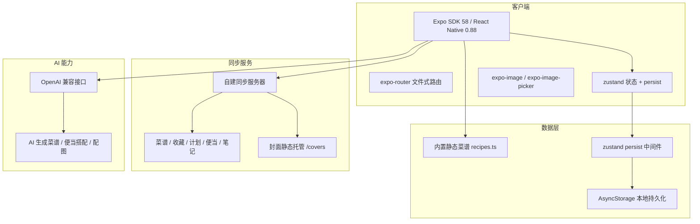

# 菜谱应用技术架构文档

> 历史说明：本文档早期版本描述的是「Vite + React Web + Tauri 桌面端」方案，该方案已废弃。
> 当前工程为 **Expo (SDK 58) + React Native + expo-router** 的移动端应用，Expo 工程位于 `mobile/`。

## 1. 架构设计



## 2. 技术选型

### 2.1 客户端技术栈
- **框架**：Expo SDK 58 / React Native 0.88 / React 19
- **语言**：TypeScript（`strict: true`）
- **路由**：expo-router（文件式路由，`main: expo-router/entry`）
- **状态管理**：zustand + `persist` 中间件（AsyncStorage）
- **UI**：`lucide-react-native` 图标 + 自建主题常量（`src/constants/theme.ts`）
- **网络**：`fetch` + `wrapCorsProxy`（Web 端走 Metro 反向代理）
- **编译器**：React Compiler 已开启（`experiments.reactCompiler`）

### 2.2 工程与打包
- **构建方式**：CNG（Continuous Native Generation），`android/` `ios/` 由 `expo prebuild` 生成，不入库
- **包管理**：bun workspace（仓库根 `package.json` 声明 `workspaces: ["mobile"]`）
- **安装策略**：`bunfig.toml` 固定 `linker = "hoisted"`，避免 isolated 依赖模式导致原生包解析异常
- **Web 调试**：`expo start --web` 输出 SPA（`web.output: "single"`），Metro 内置 `/__proxy` 反代供浏览器调试跨域接口

### 2.3 数据存储
- 内置菜谱：`mobile/src/data/recipes.ts`（静态数据，随包发布）
- 用户数据：zustand persist → AsyncStorage（收藏、导入菜谱、周计划、便当盒、笔记）
- 云同步：`mobile/src/lib/cloudSync.ts`，双向同步 payload（favorites / importedRecipes / weeklyPlan / notes / bento / settings）
- 封面：`public/covers/`（服务器托管源）+ `mobile/assets/covers/`（App 内 `require` 兜底）

## 3. 路由定义

| 路由 | 页面 | 功能描述 |
|------|------|----------|
| `/(tabs)/index` | 首页 | 分类导航、热门推荐 |
| `/(tabs)/recipes` | 菜谱列表 | 分类分段、搜索、卡片布局 |
| `/(tabs)/weekly-plan` | 便当盒 | 一周三餐搭配、食材采购清单 |
| `/(tabs)/profile` | 我的 | 设置、AI 配置、同步配置、更新检查 |
| `/recipe/[id]` | 详情页 | 菜谱详情、编辑、加入便当盒 |
| `/favorites` | 收藏页 | 收藏列表 |
| `/search` | 搜索页 | 关键词搜索 |
| `/notes` | 笔记页 | 食谱笔记 |
| `+not-found` | 兜底页 | 未匹配路由 |

## 4. 项目结构

```
lzyRecipe/                       ← 仓库根 = bun workspace 根
├── package.json                 workspace 声明 + 代理脚本
├── bunfig.toml / bun.lock       bun 安装策略与锁文件
├── scripts/                     封面生成 / 下载脚本
├── public/covers/               同步服务器封面托管源
├── docs/                        补充文档
└── mobile/                      ← Expo 应用
    ├── app.json                 CNG 应用配置
    ├── tsconfig.json            @/* → ./src/*
    ├── metro.config.js
    ├── eslint.config.js
    ├── assets/                  covers/（本地兜底封面）、images/（图标）
    └── src/
        ├── app/                 路由（expo-router）
        ├── components/          UI 组件
        ├── constants/           主题常量
        ├── data/                内置静态数据
        ├── hooks/               自定义 Hook
        ├── lib/                 业务逻辑（同步 / AI / 封面 / 上传）
        ├── store/               zustand 状态
        └── types/               类型定义
```

## 5. 组件设计

### 5.1 公共组件
| 组件 | 描述 |
|------|------|
| `RecipeCard` / `RecipeImage` | 菜谱卡片与封面渲染（本地兜底 → 服务器 URL → 占位图三级降级） |
| `BottomSheetModal` | 通用底部弹层（软键盘避让、拖拽关闭） |
| `CustomFeedback` | 全局 Toast / 确认弹窗，替代系统 Alert |
| `RecipeEditModal` | 菜谱编辑与 AI 一键生成 |
| `RecipeCoverModal` / `RecipeCoverModal` | 封面选择（百度搜图 / AI 生图） |
| `AddToMealPlanModal` / `RecipePoolSheet` | 加入便当盒与自选池 |
| `GrocerySheet` | 采购清单 |
| `AiSettingsModal` / `SyncSettingsModal` | AI 接口与云同步配置 |

### 5.2 状态（store）
| Store | 职责 |
|------|------|
| `favoritesStore` | 收藏列表 |
| `importedRecipesStore` | 用户导入/编辑的菜谱（自动补时间戳、去重、触发同步） |
| `weeklyPlanStore` | 周计划 |
| `bentoStore` / `mealPlanSheetStore` / `todayPlateStore` | 便当盒相关 |
| `notesStore` | 笔记 |
| `settingsStore` | AI 配置、同步配置、主题偏好 |
| `feedbackStore` | Toast / 确认弹窗 |

## 6. 主题配置

```typescript
// mobile/src/constants/theme.ts
export const Palette = {
  canvas: '#F5F2EB',    // 底层燕麦暖画布
  primary: '#D96B38',   // 焦糖柿子橙主强调色
  sage: '#4E7D63',      // 简单难度 / 健康
  amberWarm: '#C87D28', // 家常难度
  roseWarm: '#C4514B',  // 进阶难度 / 收藏
  ink: '#26211E',       // 深炭棕主文字
  inkMuted: '#857C74',  // 次级文字
  cocoa: { 900, 700, 400, 200 },
  oat: { 50, 100, 200 },
};
```

## 7. 打包配置

### 7.1 Android
- 包名：`com.anonymous.mobile`（上架前需换成正式包名）
- `predictiveBackGestureEnabled: false`

### 7.2 iOS
- 图标：`assets/expo.icon`（Xcode 图标集）
- 权限文案由 `expo-image-picker` 配置插件注入（相册 / 相机）

### 7.3 发布
- `eas build` / `eas submit` 云端构建与提交
- 应用内「检查更新」读取 GitHub Releases：`https://api.github.com/repos/lzyszds/lzyRecipe/releases`
